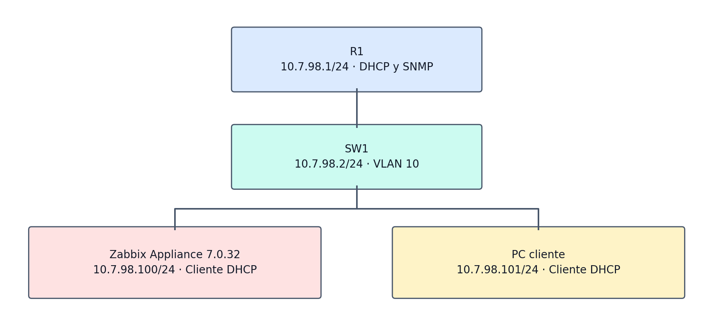
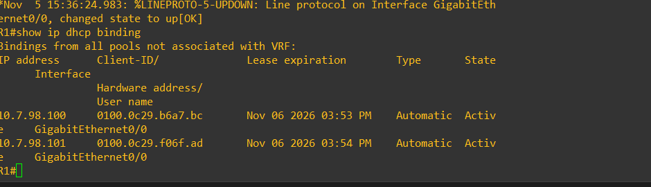
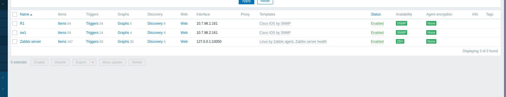
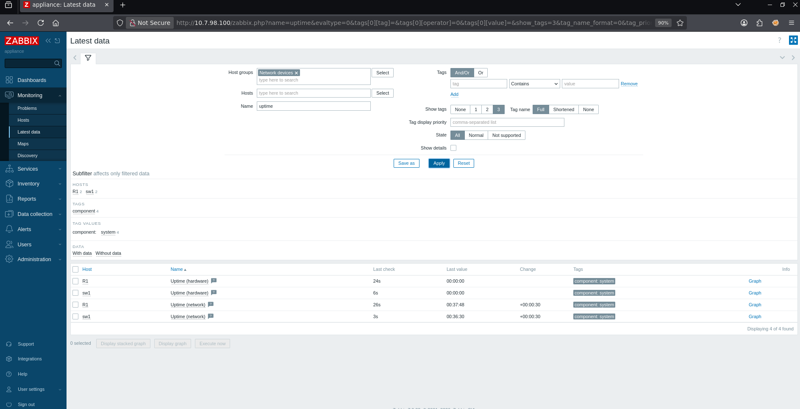

**Video demostrativo en YouTube: https://youtu.be/SCWoeVR_2io

# Monitoreo de router y switch con Zabbix y SNMP

**Autor:** Emmanuel Orlando Rodríguez Núñez  
**Matrícula:** 20250798  
**Asignatura:** Seguridad de Redes  
**Fecha:** 5 de noviembre de 2026

## Propósito

Monitorear un router y un switch mediante Zabbix y SNMP de solo lectura, con direccionamiento DHCP en la LAN. El objetivo de seguridad es consultar el estado de los dispositivos sin conceder escritura mediante la comunidad SNMP.

## Topología lógica

| Equipo | Dirección | Función |
|---|---|---|
| R1 | 10.7.98.1/24 | Puerta de enlace, DHCP y agente SNMP |
| SW1 | 10.7.98.2/24 | Gestión en VLAN 10 y agente SNMP |
| Zabbix Appliance 7.0.32 | 10.7.98.100/24 por DHCP | Servidor de monitoreo |
| PC cliente | 10.7.98.101/24 por DHCP | Pruebas y navegador |

Los puertos Gi0/0, Gi0/1 y Gi0/2 del switch pertenecen a VLAN 10. El diagrama representa relaciones lógicas; la captura de la topología del simulador está pendiente de incorporar.

## Implementación

1. Configurar R1 con 10.7.98.1/24 en Gi0/0, el pool DHCP LAN y la exclusión de .1 a .99.
2. Crear VLAN 10 en SW1 y aplicar sus puertos de acceso y la SVI 10.7.98.2/24. Consultar [la nota de recreación](configs/LEEME.md).
3. Conectar Zabbix Appliance y la PC a la LAN con DHCP. El DHCP de la red virtual del hipervisor debe estar desactivado para que las concesiones provengan de R1.
4. Configurar `snmp-server community Lab20250798 RO` en ambos equipos.
5. En Zabbix crear los hosts R1 y sw1 en Network devices, con interfaz SNMP, sus respectivas IP, puerto 161, SNMPv2 y comunidad Lab20250798.
6. Vincular la plantilla Cisco IOS by SNMP y comprobar valores recientes en Monitoring > Latest data.

El servidor del laboratorio es el appliance. No requiere la instalación manual de paquetes para Ubuntu ni una configuración Netplan.

## Pruebas verificadas

| Prueba | Resultado |
|---|---|
| DHCP del servidor y la PC | .100 y .101 con concesiones automáticas activas en R1 |
| ICMP desde la PC a R1, SW1 y Zabbix | 4 de 4 respuestas por destino; 0 % de pérdida |
| Comunidad SNMP | Lab20250798 RO en R1 y SW1 |
| Disponibilidad SNMP | Verde en ambos hosts |
| Uptime de red en Zabbix | R1 00:37:48; sw1 00:36:30 en la captura |

En la vista general se observaron tres elementos no soportados de la plantilla. Los datos de uptime de red de ambos dispositivos sí se recibieron.

## Archivos

- [Informe PDF](documentacion/EmmanuelRodriguez_20250798_Zabbix_SNMP.pdf)
- [Informe Word editable](documentacion/EmmanuelRodriguez_20250798_Zabbix_SNMP.docx)
- [Running-config de R1](configs/R1_running-config.txt)
- [Running-config de SW1](configs/SW1_running-config.txt)
- [Notas para recrear la VLAN](configs/LEEME.md)
- [Imágenes](imagenes/)
- [Diagramas PNG, SVG y Mermaid](diagramas/)

No se utilizaron scripts personalizados de automatización durante la configuración. Los comandos y las configuraciones empleados están documentados en el informe y en configs/.

## Pendientes de entrega

Consultar [PENDIENTES.md](PENDIENTES.md). El repositorio de GitHub y el video de YouTube todavía no se han creado o vinculado en este paquete.
